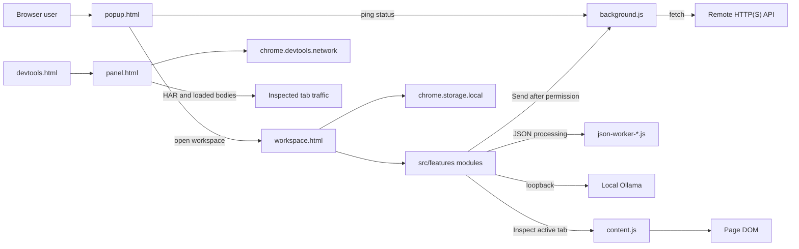

<p align="center">
  
</p>

# DevLens

**Your browser. Your developer toolkit.**

> **Status:** source version `0.1.0`. All six modules are implemented and
> covered by automated tests. Manual Chrome, Edge, and Brave QA and release
> hardening are still pending. See
> [Testing and browser compatibility](#testing-and-browser-compatibility) and
> [Roadmap](#roadmap).

## Contents

- [Project introduction](#project-introduction)
- [Features overview](#features-overview)
- [Screenshots and visuals](#screenshots-and-visuals)
- [Technology stack](#technology-stack)
- [Requirements](#requirements)
- [Installation guide](#installation-guide)
- [Local AI setup](#local-ai-setup)
- [Privacy and security](#privacy-and-security)
- [Project architecture](#project-architecture)
- [Development guide](#development-guide)
- [Testing and browser compatibility](#testing-and-browser-compatibility)
- [Roadmap](#roadmap)
- [Contributing](#contributing)
- [License and acknowledgements](#license-and-acknowledgements)
- [Troubleshooting and FAQ](#troubleshooting-and-faq)
- [Documentation](#documentation)

## Project introduction

DevLens is a local-first developer toolkit packaged as a Chromium Manifest V3
browser extension. It combines network inspection, JSON and JWT utilities, API
request testing, local AI code assistance, and page inspection in one focused
workbench that runs inside Brave, Chrome, or Edge.

Developer workflows are often split across browser panels, command-line tools,
editor scratch files, and cloud services. Moving data between them adds
friction and can expose payloads, tokens, or request details to systems that do
not need them. DevLens addresses that by keeping common inspection and testing
tasks in the browser and processing data on the local machine wherever the
feature allows it.

The local-first approach is deliberate:

- There is no DevLens backend, cloud AI provider, analytics, or telemetry
  integration in the source.
- JSON processing, JWT decoding, network inspection, and page inspection happen
  locally.
- API requests are sent only after an explicit **Send** action and a
  user-granted origin permission.
- Local AI requests go only to a validated loopback Ollama endpoint after the
  user connects or sends a message.
- Page inspection runs only after the user presses **Inspect page**.

Local-first does not mean the extension never uses the network. API Builder
sends the request you compose to the URL you choose, Local AI communicates with
the Ollama service running on your machine, and Network Inspector reads the
traffic already exposed by the inspected tab's DevTools session.

DevLens is intended for frontend developers, backend developers, students, and
web developers who want a practical, privacy-conscious browser workbench for
everyday API and page debugging. It is not a replacement for the full browser
DevTools suite, a security audit tool, a cryptographic JWT verifier, or a
network proxy.

## Features overview

All six modules are functional in the current source. Five run in the full-page
workspace; Network Inspector runs in a dedicated DevTools panel.

| Module | Surface | Focus |
| --- | --- | --- |
| Network Inspector | DevTools panel | Capture, filter, and inspect page requests |
| JSON Studio | Workspace | Format, minify, validate, and explore JSON |
| JWT Inspector | Workspace | Decode tokens and inspect registered claims |
| API Builder | Workspace | Compose, send, inspect, and cancel HTTP requests |
| Local AI Assistant | Workspace | Chat with local Ollama models and review code |
| Page Inspector | Workspace | Take a read-only snapshot of the active page |

### 1. Network Inspector

Open DevTools for the page you want to inspect and select the **DevLens
Network** panel. The panel:

- Captures requests from the inspected tab's DevTools network session and seeds
  the list from a `getHAR()` snapshot when the panel opens.
- Keeps a bounded in-memory session of up to 1,000 entries, with pause, resume,
  clear, and summary counts.
- Filters by URL, host, method, status class, and resource type.
- Shows Overview, Request, Response, and Timing details, including headers,
  query parameters, post data, sizes, duration, and normalized initiator
  information with a bounded call stack.
- Loads response previews on demand through DevTools `getContent()`. JSON is
  formatted, text is shown as text, and previews are capped at 1 MiB with
  explicit empty, binary, unavailable, malformed, and unsupported-encoding
  states.
- Generates a single-line POSIX cURL command for a selected request, including
  captured headers and request payload data, with a sensitive-data warning.
- Exports the captured session as HAR 1.2. HAR response content includes only
  bodies the user explicitly loaded during the session, capped at 1 MiB, with a
  truncation note when needed.

Captures, loaded previews, copied commands, and HAR payloads stay in memory.
Snapshot entries already present in `getHAR()` do not expose body accessors, so
their response bodies cannot be loaded. Chrome may still materialize the full
body internally when `getContent()` runs; DevLens only displays and retains the
capped preview.

### 2. JSON Studio

JSON Studio provides a CodeMirror 6 editor and local processing for JSON
payloads:

- Format with 2- or 4-space indentation, minify, validate, copy, swap, and
  clear.
- Process JSON in a Web Worker, with a synchronous fallback when workers are
  unavailable.
- Explore the last successful parse in a collapsible tree with object keys,
  array indexes, type pills, node counts, depth, and bounded rendering.
- Show line and column information when the JSON engine provides it, with a
  jump-to-error action.
- Keep input, output, tree state, and errors in memory for the active screen.

The tree renders at most 100 children per container and 40 depth levels, with
explicit controls for showing more children and a depth-limit message. There is
no dedicated JSON search or replace UI in this release; tree exploration and
editor navigation are the supported workflows.

### 3. JWT Inspector

JWT Inspector decodes compact JWTs locally:

- Splits and validates the three Base64URL segments and decodes the header and
  payload as JSON objects.
- Shows read-only, syntax-highlighted header and payload JSON, the raw signature
  segment, and copy actions for each part.
- Explains the registered claims `exp`, `iat`, `nbf`, `iss`, `sub`, `aud`, and
  `jti`.
- Renders numeric dates against the local clock and classifies expired,
  not-yet-valid, future-issued, missing, and non-standard values.
- Keeps a visible unverified-signature warning, including for tokens with an
  empty signature.

**The signature is never cryptographically verified.** Decoding a JWT does not
prove who issued it or that it has not been modified. Tokens and decoded
results stay in component memory and are not persisted, logged, or transmitted.

### 4. API Builder (request builder)

API Builder composes and executes HTTP requests:

- Supported methods are `GET`, `POST`, `PUT`, `PATCH`, and `DELETE`.
- Enter an absolute `http://` or `https://` URL and manage enabled or disabled
  query-parameter and header rows.
- Choose no body, `application/json`, `text/plain`, or
  `application/x-www-form-urlencoded`, then edit the body text.
- Send through the background service worker after the browser grants access to
  the request origin. The background checks permission with
  `chrome.permissions.contains`; the **Send** click requests the missing origin
  from the user gesture.
- Inspect status, status text, duration, content type, final URL, response
  headers, and body. HTTP 4xx and 5xx responses are preserved as responses
  rather than reported as transport failures.
- Format JSON responses through the local JSON formatter, with raw-text fallback
  for malformed JSON, plain-text handling, and an explicit empty state.
- Cancel an in-flight request while the service worker remains alive.
- Apply a default 30-second request timeout and reject response bodies over
  2 MiB before the full body is buffered.

Request drafts, headers, bodies, and responses stay in memory. Collections,
environments, history, replay, authentication helpers, and Copy as cURL/fetch
are not implemented.

### 5. Local AI Assistant

Local AI Assistant connects to an Ollama service on the same machine:

- Validate and connect to a loopback-only Ollama base URL. The default is
  `http://127.0.0.1:11434`.
- Request access to that origin from the **Check connection** or **Send** user
  gesture, read `GET /api/tags`, and list installed models.
- Persist only the normalized endpoint and selected model in
  `chrome.storage.local`.
- Chat with the selected model using streamed `POST /api/chat` responses. Send
  with **Send** or `Enter`; use `Shift` + `Enter` for a newline.
- Stop generation, start a new chat, copy a complete response, and copy
  individual code blocks.
- Render a safe Markdown subset as React nodes, without injected HTML or a
  Markdown dependency.
- Use **Chat**, **Explain code**, **Review code**, or **Debug** modes with prompt
  templates. Explain and Review require an explicitly entered code snippet.
  Debug accepts code, error output, or both.

Prompts, responses, model metadata, connection state, conversation messages,
and explicitly entered code or errors stay in memory. DevLens never attaches
page, network, API, JWT, cookie, or storage data to a Local AI request
automatically. Saved conversations, cross-session history, retrieval, and
automatic payload context are not implemented.

### 6. Page Inspector

Page Inspector takes a read-only snapshot of the page you were viewing when you
opened DevLens:

- Open the popup on a normal page, choose **Page Inspector**, then press
  **Inspect page** in the workspace.
- Inject the built `content.js` on demand with `activeTab` and `scripting`; the
  content script is not registered under `content_scripts`.
- Show Overview metadata: title, URL, meta description, canonical URL,
  language, and viewport.
- Show document Structure with H1-H6 headings, missing-H1 and heading-level-jump
  flags, and a bounded heading collection.
- Inspect Links, Images, and Forms, including link text and targets, image alt
  text and dimensions, form actions and methods, and control labels,
  placeholders, and required/disabled state.
- Produce lightweight Accessibility findings such as missing alt text,
  unlabeled controls, empty links, missing title/language/meta/viewport,
  missing or multiple H1 elements, heading jumps, and a missing main landmark.

Form metadata comes from labels and attributes only. DevLens does not read or
display entered values, passwords, cookies, local or session storage, or
authentication data. Snapshots stay in memory and are never persisted,
transmitted, or attached to Local AI automatically. Restricted pages such as
browser internals and the Web Store cannot be inspected. Accessibility findings
are heuristics, not a WCAG compliance claim.

Open Graph, script, and stylesheet panels are not implemented.

## Screenshots and visuals

Project screenshots are not yet available in this repository. Screenshots of the
popup, the workspace modules, and the DevTools panel will be added after manual
Chrome, Edge, and Brave QA so the README reflects a manually verified build.

The only committed images are the generated extension icons in
`public/icons/`; the 128 px icon is used above.

## Technology stack

| Area | Technology |
| --- | --- |
| UI | React 19, React DOM |
| Language | TypeScript 7 with strict type checking |
| Build | Vite 8 with Rolldown, two-pass extension build |
| Styling | Tailwind CSS 4, CSS-first theme tokens |
| Extension platform | Chrome Extension Manifest V3, `chrome.*` APIs |
| Editor | CodeMirror 6 with `@codemirror/lang-json` |
| Testing | Vitest 5, Testing Library, jsdom |
| Local AI | Ollama HTTP API (`/api/tags`, `/api/chat`), no SDK |
| Packaging | npm and `package-lock.json` |

DevLens intentionally does not use a routing library, a state-management
library, a Markdown renderer, an icon library, or a remote font service. Icons
are inline SVG components and fonts are system stacks.

## Requirements

- Node.js **22.12.0 or newer**.
- npm. The repository commits `package-lock.json`; use npm rather than switching
  package managers.
- A Chromium-based Brave, Google Chrome, or Microsoft Edge build capable of
  loading Manifest V3 extensions. The manifest declares
  `minimum_chrome_version` as `116`.
- Ollama is optional and is required only for the Local AI Assistant.

The project was developed with Node 24.21 and npm 11.19.

## Installation guide

### 1. Clone the repository

```bash
git clone https://github.com/TabiqZargar/DevLens.git
cd DevLens
```

### 2. Install dependencies

```bash
npm install
```

### 3. Build the extension

```bash
npm run build
```

This runs the TypeScript check, builds the extension pages and hashed JSON
worker, builds `background.js` and `content.js`, and verifies the generated
artifacts. A successful build ends with a verification message from
`scripts/verify-build.mjs`.

### 4. Locate the generated `dist/` directory

After the build, `dist/` is created at the repository root:

```text
dist/
  manifest.json
  popup.html
  workspace.html
  devtools.html
  panel.html
  background.js
  content.js
  icons/
  assets/
```

`dist/` is generated and ignored by Git. Do not edit or commit it. Load this
directory, not the repository root, in the browser.

### 5. Load the unpacked extension

The same `dist/` output is used in all three browsers.

| Browser | Extensions page |
| --- | --- |
| Google Chrome | `chrome://extensions` |
| Microsoft Edge | `edge://extensions` |
| Brave | `brave://extensions` |

For the browser you are testing:

1. Open the extensions page above.
2. Enable **Developer mode**.
3. Click **Load unpacked**.
4. Select the generated `dist/` directory.
5. Pin DevLens to the toolbar if you want quick access.
6. If the extension reports an error, inspect the extension card details and the
   browser's extension error log.

### 6. Open the popup, workspace, and DevTools panel

- **Popup:** click the DevLens toolbar icon. It shows background-worker status,
  all six module shortcuts, and an **Open workspace** button.
- **Workspace:** click a module card, or choose **Open workspace**. The workspace
  opens as a full-page tab with hash routes such as `#/json` and `#/page`.
- **DevTools panel:** open DevTools with `F12`, `Ctrl` + `Shift` + `I` on
  Windows/Linux, or `Cmd` + `Option` + `I` on macOS, then choose **DevLens
  Network** from the panel tabs. If the tab is hidden, look in the panel overflow
  menu.

Network Inspector is a DevTools surface. Selecting its popup card opens a
workspace guide with instructions rather than providing network capture inside
the popup.

After rebuilding, click the reload button on the extension card and refresh any
inspected page so its DevTools panel loads the new code. There is no HMR inside
the extension.

## Local AI setup

DevLens does not install or manage Ollama. The assistant requires a locally
running Ollama service and at least one installed model.

### 1. Install and start Ollama

Install Ollama using its normal installer, then make sure the service is
running. The desktop application may already run the service in the background.
To start it manually:

```bash
ollama serve
```

### 2. Pull a model

DevLens does not enforce a model family, parameter size, or quantization level.
Any installed model that works with Ollama's chat API can be selected. For
example:

```bash
ollama pull <model>
ollama list
```

### 3. Connect from DevLens

1. Open the workspace and choose **Local AI Assistant**.
2. Confirm the endpoint. The default is `http://127.0.0.1:11434`.
3. Press **Check connection**. The browser asks for access to that loopback
   origin.
4. After `/api/tags` succeeds, select an installed model from the model list.
5. Start with **Chat**, **Explain code**, **Review code**, or **Debug**.

Only the normalized endpoint and selected model are stored. Changing the
endpoint clears the selected model if the endpoint changed.

### 4. Use the assistance modes

- **Chat** asks a general development question without requiring attached code.
- **Explain code** requires an explicit code snippet and explains behavior,
  data flow, assumptions, and edge cases.
- **Review code** requires an explicit code snippet and looks for correctness
  problems, readability issues, and focused improvements.
- **Debug** accepts an explicit error message, code, or both and asks for
  likely causes, confirmation checks, and the smallest safe fix.

Prompt templates fill the composer and can be edited before sending. Only the
explicitly entered code, language, and error fields are attached, through one
constrained system message, when the user presses **Send**.

### 5. Endpoint and local-only restrictions

The endpoint must be a base HTTP(S) URL on `localhost`, `127.0.0.1`, or `[::1]`.
Credentials, paths, queries, and fragments are rejected before DevLens asks for
permission or makes a request. Connection checks use no credentials, reject
redirects, time out after 5 seconds, and cap metadata at 1 MiB. Chat streams
NDJSON with a 120-second inactivity timeout, a 2 MiB response cap, and
`AbortController` cancellation.

Ollama may reject the extension's origin even when the endpoint is loopback.
Start Ollama with `OLLAMA_ORIGINS` set for the extension origin:

```bash
# macOS / Linux
OLLAMA_ORIGINS=chrome-extension://* ollama serve
```

```powershell
# Windows PowerShell
$env:OLLAMA_ORIGINS = "chrome-extension://*"
ollama serve
```

If Ollama is already running, restart it after changing `OLLAMA_ORIGINS`.

### 6. Common connection and model-discovery issues

- **Connection refused or unavailable:** confirm Ollama is running and that
  `curl http://127.0.0.1:11434/api/tags` returns JSON on the machine running the
  browser.
- **Permission denied:** press **Check connection** or **Send** again and allow
  the browser prompt for the loopback origin.
- **CORS or origin rejection:** restart Ollama with `OLLAMA_ORIGINS` configured
  for the extension origin.
- **No models installed:** run `ollama pull <model>` and check the connection
  again.
- **Saved model is missing:** the model was removed from the endpoint or the
  endpoint changed. Select a currently installed model.
- **Timeout:** confirm the Ollama service is responsive; connection checks use a
  5-second timeout and chat uses a 120-second inactivity timeout.

## Privacy and security

### Local-first data handling

DevLens has no application backend, no cloud AI provider, no analytics, and no
telemetry integration in the source. Data handling is intentionally split
between in-memory feature state and the few settings that need to survive a
reload.

| Area | Behavior |
| --- | --- |
| JSON payloads | Stay in memory for the active screen; no persistence, history, telemetry, or remote request. |
| JWT tokens and claims | Stay in memory; no persistence or transmission. Signatures are never verified. |
| API drafts and responses | Stay in memory; requests go only to the URL you send to after permission. Background code does not persist or log request or response data. |
| Network captures and previews | Stay in memory for the DevTools session; response bodies load only on request. cURL and HAR export are explicit actions. |
| Local AI prompts and responses | Sent only to the validated loopback Ollama endpoint; transcript and explicit code/error context stay in memory. Only endpoint and model settings are persisted. |
| Page snapshots | Stay in memory; no persistence, external transmission, page mutation, or automatic Local AI attachment. |
| Settings | `chrome.storage.local` stores the normalized Ollama endpoint and selected model under the settings key. |

### Permissions

The active manifest requests only:

| Permission | Purpose |
| --- | --- |
| `storage` | Save the Local AI endpoint and selected model. |
| `activeTab` | Grant temporary access to the active tab after the user opens the popup and starts Page Inspector. |
| `scripting` | Inject `content.js` into the selected tab only after the user presses **Inspect page**. |

`optional_host_permissions` declares `http://*/*` and `https://*/*`. These are
not granted at install time. API Builder and Local AI request a single origin
from a user gesture when access is missing. Origin patterns use protocol plus
hostname and omit ports, because extension match patterns do not support ports.

The extension does not register an always-on content script and does not request
broad host permissions. The DevTools panel uses the `devtools_page` manifest key
and reads the inspected tab's existing DevTools network data.

### Sensitive data and limitations

- JWT decoding is inspection only. A decoded token is not authenticated, and the
  algorithm in the header is not proof of validity.
- API requests may contain credentials or sensitive headers and are sent to the
  origin you choose. DevLens does not provide a trusted proxy or credential
  vault.
- Network captures, Copy as cURL output, and HAR exports can contain
  authorization headers, cookies, request bodies, or response data. Copy and
  export only when you intend to move that data.
- Loaded HAR response bodies are included only when you explicitly load them,
  but Chrome may materialize a full response internally before DevLens receives
  the capped preview.
- Local AI sends prompts, code, and errors to the local Ollama service. The
  model and service may retain or log data depending on your Ollama
  configuration; do not submit secrets or regulated data without reviewing that
  setup.
- Page Inspector never reads entered form values, passwords, cookies, storage,
  or authentication data, but its accessibility output is a heuristic and not a
  compliance audit.
- DevLens cannot protect data after you copy it to the clipboard, download a HAR
  file, or send an API request to another service. Treat the local machine and
  browser profile as part of your security boundary.
- The project does not make absolute security guarantees. Review the source and
  the permissions before deploying it in a sensitive environment.

## Project architecture

DevLens has four extension entry surfaces and two background/injection contexts.
The popup and workspace are ordinary extension pages; the DevTools page only
registers the network panel; and `background.js` is an MV3 ES-module service
worker. `content.js` is built as a classic IIFE and injected on demand by Page
Inspector.



There is no DevLens application server in this diagram. The only outbound
paths are API Builder requests to a user-approved origin and Local AI requests
to the validated loopback endpoint.

```text
popup.html                Extension popup entrypoint
workspace.html            Full-page module workspace
devtools.html             Registers the DevTools panel
panel.html                DevTools network panel UI
public/manifest.json      Manifest V3 source, copied verbatim
src/background/           MV3 service worker and message handler
src/content/              Classic content script IIFE, injected on demand
src/devtools/             DevTools page bootstrap and panel UI
src/popup/                Popup launcher
src/workspace/            Hash-routed workspace shell
src/features/             Independent module screens and registry
src/components/           Shared UI, layout, and inline SVG icons
src/services/             Chrome storage, runtime, API, permission, and page wrappers
src/shared/               Pure types, module metadata, and constants
src/styles/               Tailwind v4 theme tokens and base styles
scripts/                  Worker builds, artifact verification, icon generation
docs/                     Architecture and roadmap
```

Feature logic lives in `src/features/<module>/`. `src/shared` contains pure
types and constants; `src/services` wraps browser APIs; and `src/components`
contains reusable UI. `src/shared/modules.ts` owns module metadata and hash
routing, while `src/features/registry.ts` maps module ids to screens. Add a new
module in both places.

### Build architecture

The extension uses two build passes:

1. `tsc --noEmit` checks the TypeScript source.
2. `vite build` empties `dist/` and builds the four HTML pages plus the hashed
   JSON worker asset.
3. `scripts/build-scripts.mjs` adds `background.js` as an ES module and
   `content.js` as an IIFE with `emptyOutDir: false`.
4. `scripts/verify-build.mjs` checks the generated manifest references, required
   pages, background and content bundles, icons, and the JSON worker asset.

The background and content bundles are self-contained. The background does not
import React or DOM-only modules, and the content script has no ESM imports.
The worker build must run after the page build because it preserves the existing
`dist/` output. `public/manifest.json` is copied verbatim.

## Development guide

### Commands

| Command | Purpose |
| --- | --- |
| `npm install` | Install dependencies from `package-lock.json`. |
| `npm run dev` | Start the Vite UI server. Extension APIs are unavailable. |
| `npm test` | Run both Vitest projects once. |
| `npm run test:watch` | Run Vitest in watch mode. |
| `npm run typecheck` | Run `tsc --noEmit` with strict TypeScript settings. |
| `npm run build` | Typecheck, build pages, build scripts, and verify artifacts. |
| `npm run verify` | Verify an existing `dist/` against the manifest. Run after a build. |
| `npm run icons` | Regenerate `public/icons/*.png` from the icon script. |
| `npm run preview` | Serve built HTML for inspection; not a loadable extension. |

Run one test file:

```bash
npx vitest run src/services/storage.test.ts
```

Run one test case by name:

```bash
npx vitest run -t "answers ping"
```

`npm run dev` is useful for layout and styling work, but it does not provide
Chrome extension APIs. The popup status will show Offline. Always test extension
behavior from a built `dist/` load. There is no HMR inside the extension.

### Coding conventions

- Strict TypeScript is the only static-analysis step. There is no ESLint or
  Prettier configuration in the repository.
- Use `import type` for type-only imports. The project enables
  `noUncheckedIndexedAccess` and `verbatimModuleSyntax`.
- Tailwind v4 is configured in CSS. Theme tokens and base styles live in
  `src/styles/index.css`; there is no `tailwind.config.*`.
- Reuse the shared `cn` helper, `Notice`, `Tabs`, `Spinner`, field styles, and
  inline icons instead of duplicating UI primitives.
- CodeMirror 6 is the only editor dependency. Keep the package set minimal and
  avoid editor wrappers or UI libraries.
- Do not add remote fonts, icon libraries, animation libraries, or assets that
  violate the MV3 content security policy.
- Keep browser API access in `src/services`, pure logic in feature modules, and
  shared types/constants in `src/shared`.
- Do not import React, DOM-only code, or storage services into the background.
  The background must remain usable where `window` and `localStorage` do not
  exist.
- Do not register the content script under `content_scripts`. Page Inspector
  injects it on demand through `chrome.scripting.executeScript`.
- Add permissions only with a concrete feature need, and update the manifest,
  architecture documentation, and tests together.
- Do not commit `dist/` or generated build output.
- Avoid fake data, believable placeholder UI, and unsupported claims.

### Contribution workflow

1. Open an issue or describe the change before starting a large refactor.
2. Fork the repository and create a focused branch.
3. Make the smallest coherent change.
4. Add or update tests for behavior changes.
5. Update the README, architecture, roadmap, or changelog when behavior,
   permissions, or setup changes.
6. Run `npm test`, `npm run typecheck`, and `npm run build` before opening a
   pull request.
7. Keep generated `dist/` output and secrets out of the commit.

Documentation-only changes should still be checked with `git diff --check`.
Do not add application features or permissions as part of a documentation
change.

## Testing and browser compatibility

### Automated tests

Vitest runs two projects:

- A `node` project for pure logic, including JSON processing, JWT decoding and
  claims, API request and execution contracts, settings, Ollama endpoint and
  model parsing, Local AI mode/context validation, chat NDJSON parsing, Markdown
  parsing, response formatting, cURL generation, HAR serialization, and the
  manifest contract.
- A `dom` project using jsdom for components, storage, the JSON tree and editor,
  JWT and API Builder screens, network export actions, Local AI connection and
  streaming states, explicit code/error context, Markdown/code rendering, page
  inspection collection, content handling, injection, privacy limits, and screen
  states.

Tests mock Chrome with `vi.stubGlobal`. The suite does not launch a real browser
and does not replace manual checks of permission prompts, clipboard behavior,
downloads, DevTools panel discovery, or service-worker timing.

The build gate combines typechecking, both build passes, and artifact
verification. A passing build does not mean the extension has passed manual
cross-browser QA.

### Browser compatibility

| Browser | Intended support | Manual status |
| --- | --- | --- |
| Google Chrome | Manifest V3 target; manifest minimum is Chrome 116 | Pending |
| Microsoft Edge | Chromium-based Manifest V3 target | Pending |
| Brave | Chromium-based Manifest V3 target | Pending |
| Firefox | Not supported | Not planned in the current manifest |

Brave, Chrome, and Edge share the Chromium extension platform and load the same
`dist/` output. DevLens uses the `chrome.*` namespace. Firefox would require a
different manifest and `browser.*`/promise behavior.

**Manual Chrome, Edge, and Brave QA is currently pending.** Automated tests and
successful artifact verification are not a claim that all three browsers have
passed manual end-to-end testing.

## Roadmap

The roadmap is maintained in [`docs/ROADMAP.md`](docs/ROADMAP.md). The current
implementation status is:

| Milestone | Status | Scope |
| --- | --- | --- |
| 0. Foundation | Implemented in `0.1.0` | MV3 build, popup, workspace, DevTools shell, design system, messaging, storage, tests, verifier, docs |
| 1. Network Inspector | Implemented, manual QA pending | Live capture, bounded session, filtering, details, response previews, initiators, cURL, HAR |
| 2. JSON Studio and JWT Inspector | Implemented, manual QA pending | Worker-backed JSON editing and tree exploration; local JWT decoding and claims |
| 3. API Builder | Implemented through Send, manual QA pending | Request editor, background execution, permissions, response inspection, cancellation, 2 MiB cap |
| 4. Local AI Assistant | Implemented through developer assistance, manual QA pending | Loopback Ollama, model discovery, streaming chat, safe Markdown, explicit code/error context |
| 5. Page Inspector | Implemented, manual QA pending | Explicit active-tab inspection, overview/structure/links/images/forms, accessibility heuristics |
| 6. Final integration | Implemented, manual QA pending | Shared UI primitives, keyboard navigation, metadata and copy cleanup, privacy audit |
| Hardening and release | Remaining | Cross-browser smoke tests, accessibility pass, bundle/dependency review, privacy statement, store assets, versioning and release checklist |

Known limitations and future work:

- JWT signature verification is not implemented.
- JSON Studio has no dedicated search/replace UI.
- API Builder has no collections, environments, request history, replay, auth
  helpers, or Copy as cURL/fetch.
- Local AI has no automatic payload context, saved conversation history,
  cross-session chats, or retrieval.
- Page Inspector has no Open Graph, script, or stylesheet panels.
- Firefox is not supported.
- Manual Chrome, Edge, and Brave smoke testing remains a release blocker.
- The current release has no store listing, privacy statement, or finalized
  release checklist.

## Contributing

### Report bugs

Use the repository's GitHub Issues page. Include:

- Browser and version.
- DevLens version from the popup footer or manifest.
- Steps to reproduce.
- Expected and actual behavior.
- Relevant console or extension errors.
- Whether the extension was loaded from a fresh `npm run build`.

Do not include passwords, tokens, cookies, authorization headers, private
payloads, HAR exports, AI prompts, or proprietary page content in an issue.
Redact sensitive data or use a minimal synthetic reproduction.

### Propose features

Open an issue before implementing a substantial feature. Describe the use case,
the affected module, and any permission or privacy implications. Features that
add host access, persistence, or network behavior need a clear reason and
corresponding documentation and tests.

### Submit pull requests

- Fork the repository and work on a focused branch.
- Keep unrelated changes out of the pull request.
- Add tests for new logic and component behavior.
- Update documentation when setup, permissions, modules, or limitations change.
- Run `npm test`, `npm run typecheck`, and `npm run build`.
- Run `git diff --check` before submitting.
- Do not commit `node_modules/` or `dist/`.
- Do not include secrets or real credentials in fixtures, screenshots, logs, or
  commit messages.

## License and acknowledgements

No `LICENSE` file or license declaration is present in this repository, and
`package.json` is marked private. Do not assume that DevLens is open source or
redistribute it until a license is added by the project owner.

DevLens is built with the open-source projects listed in
[`package.json`](package.json), including React, TypeScript, Vite, Tailwind CSS,
CodeMirror, Vitest, Testing Library, and jsdom. Local AI integration targets the
separate Ollama project. These acknowledgements do not imply sponsorship,
partnership, or endorsement.

## Troubleshooting and FAQ

### Troubleshooting

| Issue | Checks |
| --- | --- |
| The extension does not load | Run `npm run build`, load the generated `dist/` directory rather than the repository root, enable Developer mode, and confirm the browser is a Chromium-based build that supports Manifest V3. |
| Build artifacts are missing | `dist/` is generated and ignored by Git. Run `npm run build`, then run `npm run verify` against the fresh output. Confirm Node.js 22.12 or newer. |
| The DevTools panel does not appear | Open DevTools with `F12`, look for **DevLens Network** in the panel tabs or its overflow menu, reload the extension, and refresh the inspected page. The panel is not available in the popup. |
| Active-tab inspection fails | Open the popup on a normal `http://` or `https://` page, then reopen the workspace if the target page was reloaded or navigated. Browser internals, extension pages, and the Web Store are restricted and cannot be inspected. |
| Ollama connection fails | Confirm the service is running, use the base URL without a path or query, allow the browser permission prompt, and configure `OLLAMA_ORIGINS` if the extension origin is rejected. |
| Model discovery is empty | Run `ollama pull <model>`, verify `ollama list`, and press **Check connection** again. A saved model that is no longer installed must be replaced. |
| API Builder reports permission denied | Press **Send** again and allow the origin prompt. DevLens does not prompt from the background worker; the request begins only after the click grants access. |
| The Network panel stays empty | Open the panel before generating traffic, check that capture is not paused, and remember that snapshot bodies already present in `getHAR()` do not expose response accessors. |
| JSON output does not update | The tree and output can be marked stale after the input changes. Run Format, Minify, or Validate again. |
| A page cannot be inspected | Restricted browser pages intentionally cannot be inspected. Use a normal web page in a regular tab. |

### FAQ

**Does DevLens send telemetry or analytics?**

No analytics or telemetry integration is present in the source. Network access
is limited to the explicit API and local Ollama paths described above, plus the
DevTools APIs the panel is authorized to use.

**Does Local AI use a cloud service?**

No. It requires a loopback Ollama endpoint and rejects non-loopback hosts. The
local Ollama service and model may still log or retain data according to their
own configuration.

**Can DevLens verify a JWT signature?**

No. JWT Inspector decodes and explains claims only. It never proves authenticity.

**Does DevLens save my payloads, requests, chats, or page snapshots?**

No. JSON, JWT, API, network, Local AI conversation/context, and page snapshot data
stay in memory. The only persisted DevLens settings are the normalized Ollama
endpoint and selected model.

**Does Page Inspector read passwords or form values?**

No. It derives form metadata from labels and attributes and does not read entered
values, passwords, cookies, storage, or authentication data.

**Is Firefox supported?**

No. The current manifest and `chrome.*` APIs target Chromium browsers.

**Is DevLens release-ready?**

The six modules are implementation-complete and covered by automated tests, but
manual Chrome, Edge, and Brave QA, accessibility review, dependency review, store
assets, and release checklist work remain.

## Documentation

- [Architecture](docs/ARCHITECTURE.md)
- [Roadmap](docs/ROADMAP.md)
- [Changelog](CHANGELOG.md)
- [Agent instructions](AGENTS.md)
- [Package manifest](package.json)
- [Manifest V3 source](public/manifest.json)
